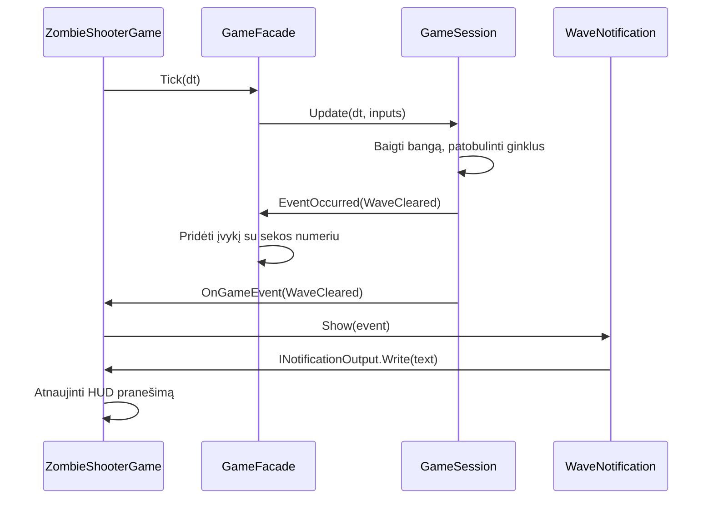

# Zombie Shooter: reikalavimai ir šablonai

Iš viršaus matomas išlikimo žaidimas: judėti, šaudyti, rinkti daiktus ir įveikti
zombių bangas. Palaikomas vienas žaidėjas, vietinis bendras žaidimas ir du klientai
per lokalų autoritetingą serverį. Paleidimas ir valdymas pateikti [README](../README.md).

## 1. Apimtis ir priėmimo kriterijai

| Sritis | Patikrinamas elgesys |
|---|---|
| Judėjimas | 220 vienetų/s; įstrižas judėjimas ne greitesnis; žaidėjas lieka 1280 × 720 arenoje už HUD ribų. |
| Kova | Pistoletas šauna 1 kulką, shotgun – 5; vienas šūvis sunaudoja vieną šovinį. Cooldown ir perkrovimas blokuoja šaudymą. Kulkos atkarpa tikrinama nuo praskridimo pro zombį. Draugiškos ugnies nėra. |
| Priešai | Walker, Runner ir Brute juda link artimiausio gyvo žaidėjo. Kontaktinė žala turi apsaugos intervalą; vienas nužudymas duoda vieną įvykį ir atlygį. |
| Daiktai | Gydymas +35 iki 100 HP; pilnų HP žaidėjas jo nesunaudoja. Shotgun suteikiamas 15 s; daiktai išnyksta po 18 s. |
| Bangos | Kita banga prasideda tik sunaikinus visus priešus ir pasibaigus pertraukai. Kiekvienas išgyvenęs žaidėjas gauna tris ginklų dekoratorius. |
| Bendras žaidimas | Abu žaidėjai valdomi atskirai. Žuvęs partneris grįžta su 50 HP ir 2 s apsauga po įveiktos bangos. Visų žūtis baigia sesiją. |
| Režimai | F3 cikliškai parenka Normal, Horde arba Brute ir pradeda naują sesiją. Tas pats pasirinkimas galimas serverio argumentu. |
| Komandos | Perkrovimas ir ginklo parinkimas vykdomi FIFO per kitą teigiamos trukmės žingsnį. Kiekvienas žaidėjas gali atšaukti vieną paskutinę galiojančią komandą. |
| Pauzė | P arba fokuso praradimas sustabdo vietinę simuliaciją. GameOver sustabdo simuliaciją ir atmeta komandas. |
| Tinklas | Du klientai mato serverio būseną ir valdo tik savo žaidėją. Vienas klientas laukia; atsijungus sesija sustoja; laisvą vietą gali perimti nauja jungtis. Trečia jungtis atmetama. |
| Izoliacija | Sesijos nepriklausomos; Core neturi MonoGame priklausomybės. Testai ir serveris veikia be grafinio lango. |
| Ribos | Komandų eilė ≤64; viename tinklo kadre ≤16 veiksmų; kadras ≤1 MiB. NaN, Infinity ir neteisingi veiksmų enum atmetami. |

Kliūčių žemėlapiai, kelio paieška, paskyros, išsaugojimas diske, garsas, klientų
prognozavimas ir keli vienalaikiai serverio kambariai neįtraukti. Seed naudojamas
atkuriamoms patikroms, o ne skirtingų platformų lockstep garantijai.

## 2. Žaidimo parametrai

Žaidėjas pradeda su 100 HP. Kulkos greitis 650, gyvavimo laikas 1,4 s.

| Zombis | HP | Greitis | Spindulys | Žala | Apsauga po smūgio | Taškai |
|---|---:|---:|---:|---:|---:|---:|
| Walker | 60 | 70 | 14 | 10 | 0,65 s | 10 |
| Runner | 35 | 125 | 14 | 8 | 0,5 s | 15 |
| Brute | 150 | 48 | 22 | 20 | 1,2 s | 25 |

Kiekviena banga po pirmos prideda 5 HP ir 2 greičio vienetus (greičio priedas ≤40).
`XpReward` reiškia taškų atlygį; atskiros XP sistemos nėra.

| Ginklas | Žala kulkai | Kulkos | Intervalas | Dėtuvė | Perkrovimas |
|---|---:|---:|---:|---:|---:|
| Pistol | 35 | 1 | 0,18 s | 12 | 1,2 s |
| Shotgun | 25 | 5 | 0,5 s | 6 | 1,8 s |

Atsarginių šovinių kiekis neribotas. Ginklo pakeitimas nutraukia perkrovimą,
išsaugo dėtuves; shotgun laikas eina ir pasirinkus pistoletą. Surinktas shotgun
parenka ginklą, užpildo jo dėtuvę ir nutraukia perkrovimą. Žuvusių žaidėjų laikmačiai sustoja.
Po bangos ginklai gauna DamageBonus (+5 pistoletui, +3 shotgun), FireRateBonus
(×0,95, bent 0,05 s) ir MagazineSizeBonus (+1). Dėtuvė automatiškai neužsipildo.

Tegu `w` – banga, `p` – žaidėjų skaičius:

| Pasirinkimas / strategija | Priešų kiekis | Atsiradimo intervalas | Pertrauka | Sudėtis |
|---|---|---|---|---|
| Normal / NormalContent | `(4 + 3w) × p` | `max(0,18; 0,85 − 0,035w)` | 4 s | Runner nuo 3, Brute nuo 5 |
| Horde / HordeMode | `(10 + 5w) × p` | `max(0,08; 0,35 − 0,01w)` | 2 s | Walker |
| Brute / BruteMode | `(2 + w) × p` | `max(0,3; 1,2 − 0,04w)` | 5 s | Brute |

Normal šeimoje daiktas iškrenta su 22 % tikimybe: pusė gydymas, pusė shotgun.
Horde ir Brute taip pat naudoja Normal turinį. Atskiro šeimos parinkimo nėra.

## 3. Šablonai ir dokumentuoti minimumai

Nightmare pašalintas sąmoningai paprastinant kodą. Trys ankstesni minimumai
nebeįvykdomi: yra 3 iš 4 strategijų, 1 iš 2 turinio šeimų ir 1 iš 2 konkrečių
builderių. Tai priimti nukrypimai, o ne visų ankstesnių reikalavimų įvykdymas.
Viena klasė gali atlikti kelių šablonų vaidmenis; dalyviai skaičiuojami kiekvienam
šablonui atskirai.

| Šablonas | Kodo dalyviai ir paskirtis | Dabartinė būsena ir kriterijus |
|---|---|---|
| Singleton | HighScores: Lazy instancija ir Interlocked maksimumas | Viena instancija; 10 000 lygiagrečių atnaujinimų patikra |
| Factory Method | ZombieCreator; WalkerCreator, RunnerCreator, BruteCreator → Walker, Runner, Brute | 3 konkrečios produktų klasės |
| Abstract Factory | IContentFactory; NormalContent | 1 šeima ir 3 produktai: EntityFactory, IGameMode, IDropPolicy. **2 šeimų minimumas neįvykdytas.** |
| Strategy | IGameMode; NormalContent, HordeMode, BruteMode | 3 pasirenkamos strategijos. **4 strategijų minimumas neįvykdytas.** |
| Observer | GameSession.EventOccurred → HUD, serverio pranešimai ir fasado įvykių eilė | Veikiantys prenumeratoriai ir sekų diagrama |
| Builder | ZombieBuilder; NormalContent; EntityFactory valdo receptus | 1 naudojamas konkretus builderis. **2 builderių minimumas neįvykdytas.** |
| Prototype | IPrototype, ZombieArchetype, AttackProfile; EntityFactory saugo ir klonuoja šablonus | Deep / shallow kopijos, nuorodos, adresai ir sąnaudos |
| Decorator | IWeapon, WeaponStats, WeaponDecorator; DamageBonus, FireRateBonus, MagazineSizeBonus | 3 vienu metu taikomi sluoksniai |
| Command | IGameCommand, PlayerCommand, ReloadCommand, SelectWeaponCommand, UndoCommand; CommandDispatcher | Būseną išsaugantis ir galiojimą tikrinantis Undo |
| Adapter | IPlayerInputSource; KeyboardMouseAdapter / KeyboardMouseDevice; ControllerAdapter / ControllerDevice | 2 adapteriai; vienas Read sujungia 3 įrenginio operacijas |
| Facade | GameFacade → InputBuffer, CommandDispatcher, GameSession | 3 posistemės; desktop ir serveris – 2 klientai |
| Bridge | GameNotification → WaveNotification, PickupNotification; INotificationOutput → ZombieShooterGame, GameServer | 2 abstrakcijos ir 2 realizacijos |

`NormalContent` apjungia keturis susijusius vaidmenis: turinio gamyklą, bangų
strategiją, daiktų kritimo taisykles ir konkretų builderį. Gamykla sukuria
EntityFactory, o per `CreateGameMode()` ir `CreateDropPolicy()` grąžina save kaip
du skirtingus produktų interfeisus.

`EntityFactory` naudoja naują NormalContent builderį. Builderio konfigūracija
nepriklauso nuo kitų sesijų, o bangų ir daiktų metodai neturi kintamos būsenos.
HordeMode ir BruteMode lieka atskiros strategijos: iš viso trys. Nebėra antros
turinio šeimos, antro builderio ar EntityFactory poklasio.

`ZombieShooterGame` ir `GameServer` yra fasado klientai, Observer prenumeratoriai
ir dvi Bridge išvesties realizacijos (`INotificationOutput`). Pranešimai priklauso
nuo išvesties sąsajos; atskirų HUD ir konsolės forwarding klasių nebereikia.
`WeaponStats` yra nekintamas Decorator komponentas ir snapshot ginklo duomenys.
Pistol ir Shotgun yra du šio tipo duomenų rinkiniai; trys konkretūs dekoratoriai
lieka atskiros klasės. Bendri baziniai duomenys nekinta dekoruojant vieną žaidėją.
`ZombieCreator.Create()` yra tiesioginis Factory Method be papildomo forwarding metodo.

Strategy keičia bangų algoritmą. Bridge atskiria pranešimo rūšį nuo išvesties vietos.
Adapter suderina įrenginio API su PlayerInput. Trumpi produktų ir adapterių tipai
palikti dėl nurodytų kriterijų; papildomų režimų kombinacijų ar forwarding klasių nėra.

Jeigu taikomas reikalavimas „bent 3 nesikartojantys šablonai studentui“, tikrieji
autoriai turi įrašyti savo atsakomybes. Šis dokumentas autorystės nepatvirtina.

## 4. UML ir vykdymas

Vienas [dabartinio kodo klasių modelis](uml/01-current-classes.svg)
([PlantUML šaltinis](uml/01-current-classes.puml)) ir atskira
[Use Case diagrama](uml/00-use-cases.puml). Pradinis istorinis klasių modelis pašalintas.
Klasių vaizde įtraukti visi `src/` deklaruoti tipai: klasės, sąsajos, record, enum,
DTO ir piešimo pagalbininkai. Pateikti visų matomumo lygių laukai, savybės, įvykiai,
konstruktoriai ir metodai su tipais, parametrais bei matomumu. Paveldėti nariai
rodomi baziniuose tipuose, o partial deklaracijos sujungtos. Pažymėti saugomi
pirminio konstruktoriaus parametrai. Kompiliatoriaus generuojami pagalbiniai nariai,
numatytieji nedeklaruoti konstruktoriai, top-level paleidimo kodas, lokalūs
kintamieji ir funkcijos bei testai į šį klasių modelį neįtraukti. Išoriniai baziniai
tipai rodomi be narių. SVG skirtas peržiūrėti didinant mastelį; generavimo komandos
pateiktos README. Rodyklės rodo paveldėjimą, sąsajų realizavimą, kompoziciją,
saugomų objektų ryšius ir pasirinktus šablonų ryšius. Vien parametrų, grąžinamų tipų
ir enum savybių priklausomybės rodyklėmis nekartojamos: tipai lieka narių parašuose.
Use Case `include` reiškia, kad F2/F3 visada pradeda naują sesiją.

Observer bangos pabaigos eiga (įvykis sinchroninis):

CommandDispatcher saugo FIFO ir paskutinę sėkmingą komandą kiekvienam žaidėjui.
Undo atkuria ginklo ir perkrovimo būseną tik toje pačioje sesijoje, kol ActionVersion
galioja. Šūvis, baigtas perkrovimas, daiktas, ginklo galiojimo pabaiga, žūtis ar bangos
patobulinimas atšaukimą panaikina. Šoviniai negrąžinami; redo nėra.

Serverio simuliacija veikia atskiru 60 Hz ciklu. Klientas siunčia PlayerInput ir
leidžiamų veiksmų enum; serveris pagal jungtį parenka žaidėjo ID ir sukuria komandas.
Užklausos atsakymas yra dabartinis snapshot, todėl dar gali nerodyti ką tik į eilę
įdėtos komandos rezultato. Prieiga prie fasado serializuojama užraktu.

TCP transportas: JSON ir 4 baitų big-endian ilgio prefiksas. Kliento ciklas laukia
16 ms, serveris taip pat riboja užklausų dažnį. Po 250 ms įvestis nunulinama; po 5 s
be užklausos jungtis nutraukiama. Kliento operacijos timeout – 3 s. Atsijungus išvaloma
įvestis, komandų eilė ir undo istorija. Fasadas laiko 128 paskutinius įvykius; snapshot
klientas naudoja sekos numerį, kad Observer įvykiai nesikartotų.

## 5. Patikra ir demonstracija

[Headless testų komanda](../README.md#run) tikrina kovą, bangas, co-op, šablonus,
undo ir tikrą TCP ryšį: du klientai, judėjimas, šaudymas, perkrovimas, atšaukimas,
atsijungimas, vietos perėmimas ir neteisingas veiksmas.
[Prototype ataskaita](PROTOTYPE_REPORT.md) aprašo deep / shallow eksperimentą.

Rankomis patikrinti: grafinį langą, pelės taikymą, P2 klaviatūrą ir valdiklį,
F2/F3, pauzę, HUD, du klientus ir serverį. Galutinei ataskaitai pridėti solo,
co-op ir tinklo demonstracijos ekrano nuotraukas. Istorinių pateikimo datų ir
studentų autorystės kodas neįrodo.
