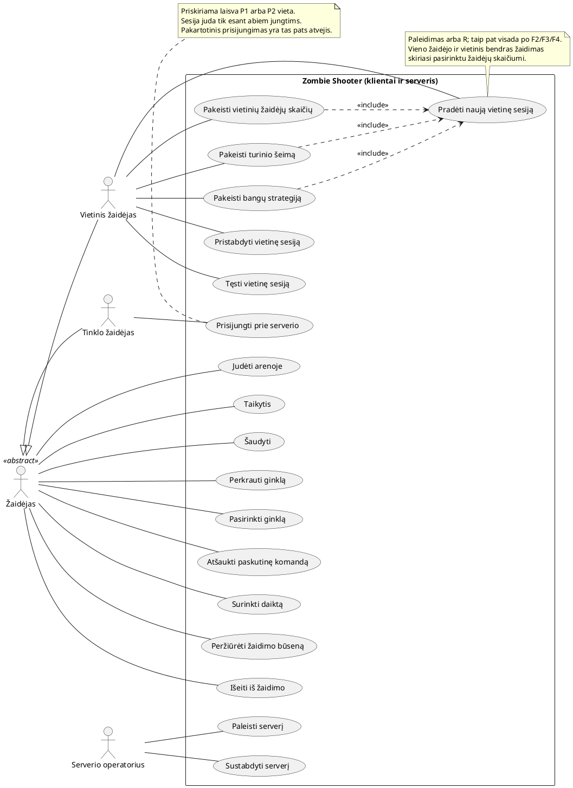
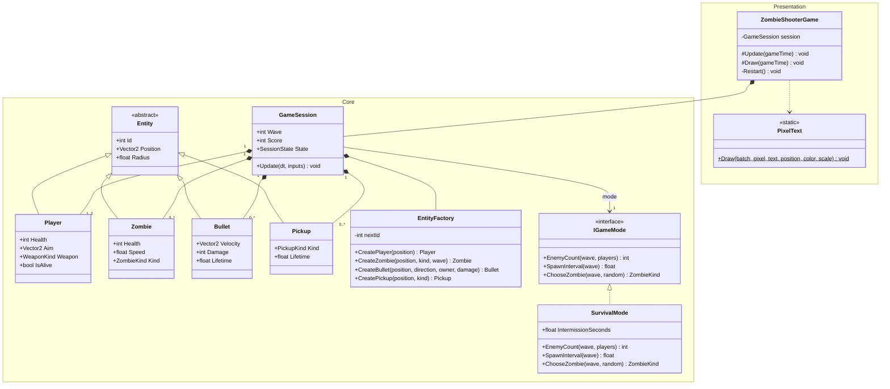
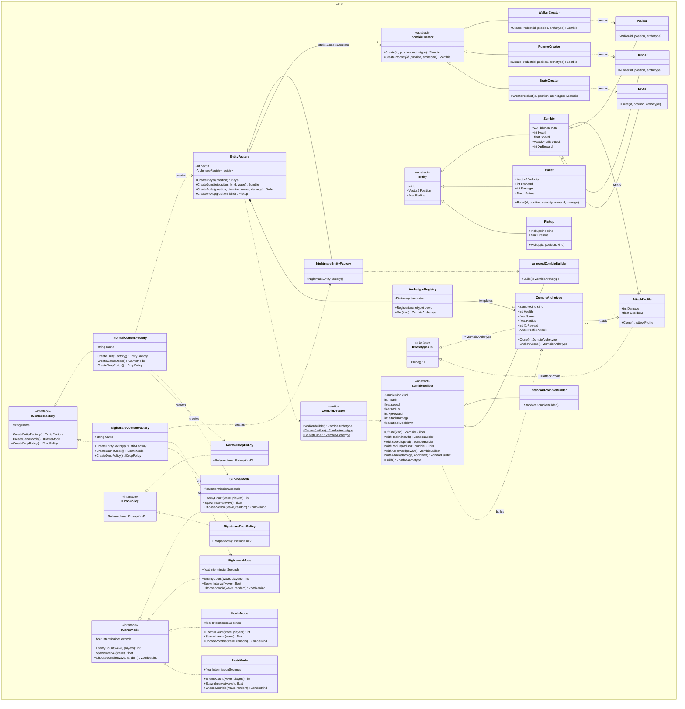
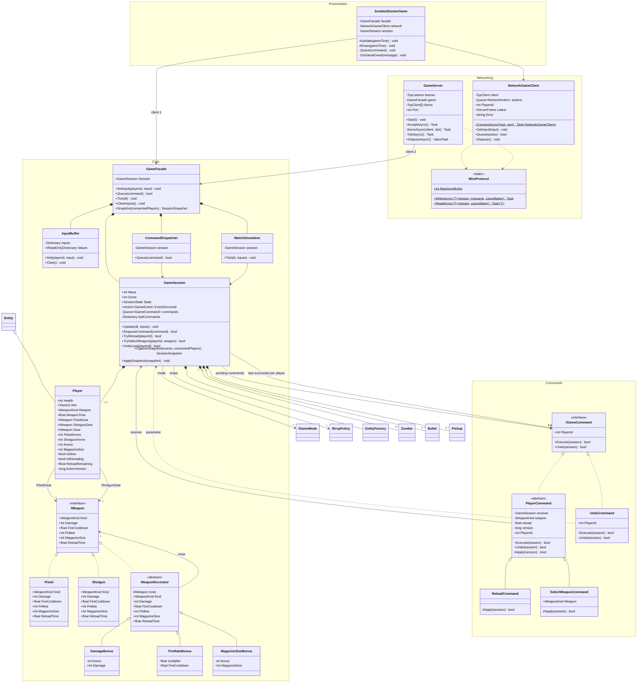
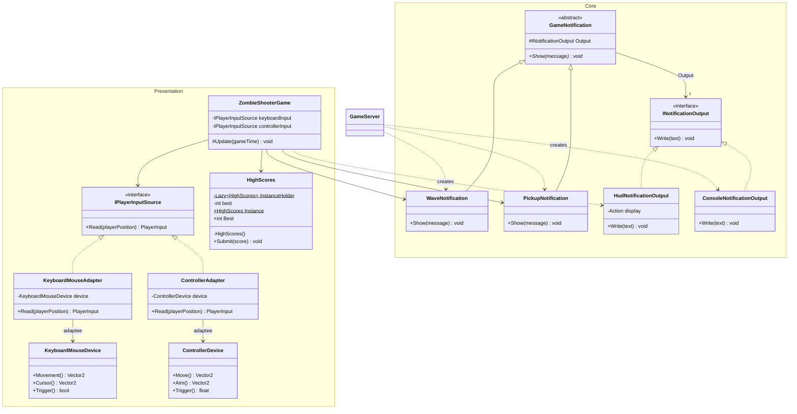
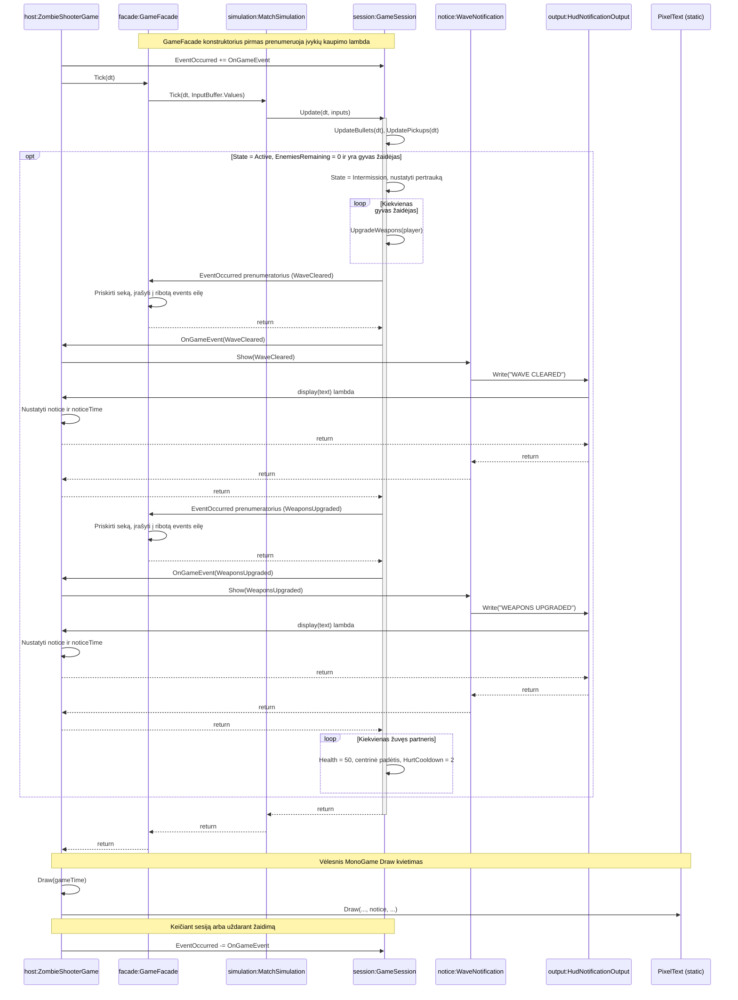
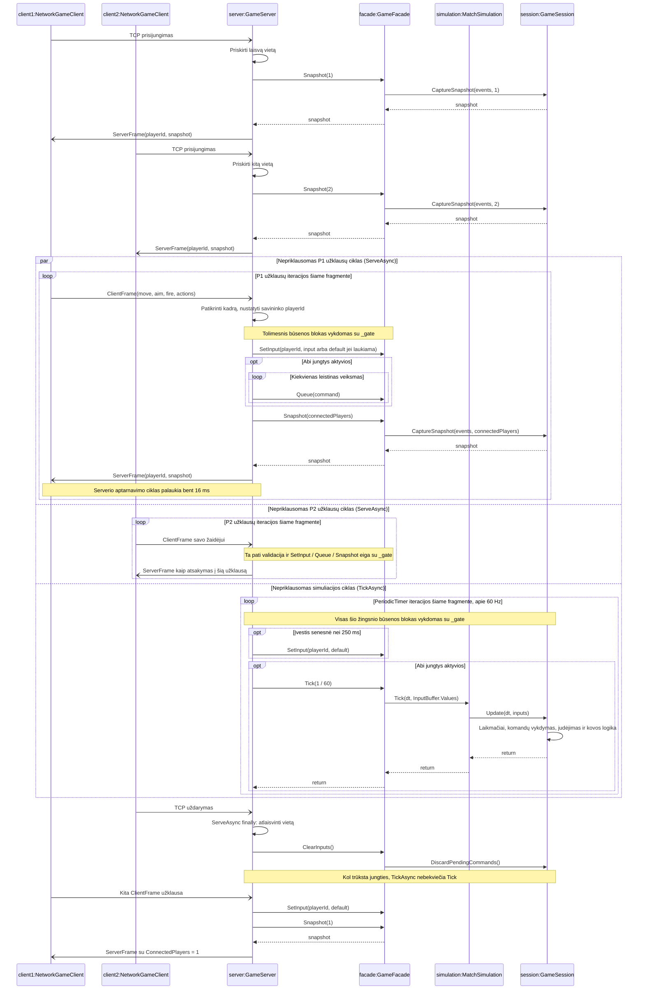

# Zombie Shooter: projekto aprašas ir atsiskaitymo medžiaga

Šis dokumentas aprašo dabartinį įgyvendinimą. README.md paliktas nepakeistas pagal užduotį; jo šablonų inventorius ir dalis taisyklių yra pasenę. Aktualūs paleidimo veiksmai, kriterijai ir šablonų dalyviai pateikiami čia.

## 1. Idėja ir tikslas

„Zombie Shooter“ – iš viršaus matomas išlikimo žaidimas, sukurtas C# ir MonoGame. Žaidėjas juda uždaroje arenoje, taikosi ir šaudo į artėjančius zombius, renka gydymo bei ginklo daiktus ir stengiasi išgyventi kuo daugiau bangų. Galima žaisti vienam, dviese prie vieno kompiuterio arba dviem atskirais klientais per lokalų serverį.

Tikslas – išgyventi kuo ilgiau ir surinkti kuo daugiau bendrų taškų. Baigtinės pergalės bangos nėra: sesija baigiasi, kai žūsta visi žaidėjai. Po kiekvienos įveiktos bangos išgyvenusių žaidėjų ginklai sustiprinami, o žuvęs partneris atgaivinamas.

### Grafiniai pavyzdžiai – vietos užpildymui

> **[G1: PAGRINDINIS ŽAIDIMO VAIZDAS]** Įterpti arenos ekrano nuotrauką su žaidėju, zombiais, kulkomis ir HUD. Pažymėti gyvybes, bangą, taškus ir šovinių skaičių.

> **[G2: VIETINIS DVIEJŲ ŽAIDĖJŲ REŽIMAS]** Įterpti vaizdą su abiem žaidėjais ir jų gyvybių juostomis.

> **[G3: KLIENTAS–SERVERIS]** Įterpti serverio konsolės ir dviejų atskirų klientų langų vaizdus. Abiejuose klientuose turi matytis ta pati banga ir abiejų žaidėjų padėtys.

> **[G4: GINKLO PATOBULINIMAI]** Įterpti vaizdus prieš ir po bangos; parodyti padidėjusią dėtuvę ir pranešimą „WEAPONS UPGRADED“.

> **[G5: PAUZĖ IR ŽAIDIMO PABAIGA]** Įterpti abu ekranus. Tinklo režime vietinė pauzė visos sesijos nestabdo.

> **[G6: UML EKSPORTAI, JEI REIKALINGI]** Toliau pateiktas Mermaid ir PlantUML diagramas eksportuoti į SVG/PNG ir įkelti į galutinę ataskaitą. Diagramų šaltiniai jau pateikti šiame dokumente.

## 2. Paleidimas

Reikalingas .NET 8 SDK ir MonoGame DesktopGL palaikanti grafinė aplinka. Pirmajam paketų atkūrimui reikalinga prieiga prie NuGet arba jau užpildytas paketų podėlis.

```sh
dotnet restore ZombieShooter.sln
dotnet build ZombieShooter.sln --no-restore
dotnet run --project src/ZombieShooter --no-build
```

Jei Linux sistemoje pelės taikymasis neveikia su naudojama langų sistema:

```sh
SDL_VIDEODRIVER=x11 dotnet run --project src/ZombieShooter --no-build
```

### Serverio demonstracija

Paleisti serverį ir **du atskirus** klientų procesus, kiekvieną savo terminale:

```sh
dotnet run --project src/ZombieShooter.Server --no-build -- 7777 normal
```

```sh
dotnet run --project src/ZombieShooter --no-build -- --connect 127.0.0.1 7777
```

```sh
dotnet run --project src/ZombieShooter --no-build -- --connect 127.0.0.1 7777
```

Serverio režimai: `normal`, `nightmare`, `horde`, `brute`. Serveris klausosi tik `127.0.0.1`; tai lokali demonstracija, ne viešas internetinis serveris. Azure nėra būtinas pagal užduotį.

Pirmas klientas gauna P1, antras – P2. Kiekviename lange savas žaidėjas valdomas WASD ir pele. Serveris pradeda simuliaciją tik esant abiem jungtims. Vienam klientui atsijungus sesija laukia; prisijungęs naujas klientas perima laisvą vietą su išlikusia jos būsena. Tai vietos perėmimas, ne naudotojo paskyros autentifikacija. Trečia jungtis atmetama. Naujai tinklinei partijai sustabdyti klientus ir serverį, tuomet paleisti iš naujo. Serveris sustabdomas Ctrl+C.

### Patikros

```sh
dotnet run --project tests/ZombieShooter.Core.Tests
```

Patikros nekuria grafinio lango, bet TCP integraciniams testams turi būti leidžiami vietiniai tinklo lizdai. Konsolėje taip pat pateikiama Singleton daugiagijiškumo patikra ir Prototype kopijų adresų, atminties sąnaudų bei trukmės demonstracija. Testų klaida nutraukia vykdymą su nesėkmės kodu.

## 3. Valdymas ir sąsaja

| Veiksmas | P1 / savas tinklo žaidėjas | Vietinis P2 |
|---|---|---|
| Judėjimas | WASD | Rodyklės / kairė valdiklio svirtis |
| Taikymasis | Pelė | IJKL / dešinė svirtis |
| Šaudymas | Laikomas kairys pelės mygtukas | Enter / dešinysis Ctrl / dešinysis gaidukas |
| Perkrovimas | E | O / X |
| Pistoletas / shotgun | 1 / 2 | 9 / 0 / LB / RB |
| Paskutinės galiojančios komandos atšaukimas | Z | N |
| Pauzė | P, tik vietiniame žaidime | Bendras veiksmas |
| Nauja vietinė partija | R | Bendras veiksmas |
| Vienas / du vietiniai žaidėjai | F2, pradeda naują partiją | Bendras veiksmas |
| Normal / Nightmare turinio šeima | F3, pradeda naują partiją | Bendras veiksmas |
| Šeimos numatytasis / Horde / Brute režimas | F4, pradeda naują partiją | Bendras veiksmas |
| Išeiti | Escape | Bendras veiksmas |

F3 parenka turinio šeimą. F4 leidžia pakeisti jos bangų strategiją: Default → Horde → Brute → Default. Normal šeimos Default yra SurvivalMode; Nightmare šeimos Default yra NightmareMode. Tinklo režime šeimą ir strategiją parenka serveris; klientų F2/F3/F4/R/P neveikia.

HUD rodo bangą, likusius priešus, bendrus taškus, gyvybes, pasirinktą ginklą, šovinius, perkrovimo ir shotgun laiką, režimą ir geriausią proceso rezultatą. Rekordas išlieka tarp vietinių sesijų, tačiau uždarius programą neišsaugomas diske. Praradus lango fokusą vietinė simuliacija sustoja; tinklo klientas siunčia nulinę įvestį, serveris gali tęsti žaidimą.

## 4. Taisyklės ir objektų savybės

### Žaidėjas, arena ir susidūrimai

- Arena yra fiksuota 1280 × 720; viršuje yra HUD. Žaidėjo centras ribojamas pagal jo spindulį, sienų ir HUD ribas.
- Žaidėjas pradeda su 100 HP, juda 220 vienetų/s, jo susidūrimo spindulys – 15. Įstrižas judėjimas nedidina greičio.
- Kiekvienas zombis juda tiesiai link artimiausio gyvo žaidėjo. Kliūčių, kelio paieškos ir zombių tarpusavio stūmimosi nėra.
- Žaidėjas–zombis: susilietus atimama zombio atakos žala, po to žaidėjas trumpam apsaugomas nuo pakartotinės žalos pagal atakos cooldown.
- Kulka–zombis: tikrinama judėjimo atkarpos ir apskritimo sankirta; pataikoma į pirmą kelyje esantį gyvą zombį. Kulka sunaikinama.
- Draugiškos ugnies nėra. Kulka gyvuoja iki 1,4 s, jos greitis 650 vienetų/s, spindulys 3.
- Žaidėjas–daiktas: gyvas žaidėjas surenka paliestą daiktą; pilnų gyvybių žaidėjas gydymo paketo nesunaudoja.
- Procedūriškai piešiama arenos tinklelio grafika, tačiau atsitiktinio žemėlapio generavimo nėra. Atsitiktinai generuojami priešų atsiradimo taškai prie keturių kraštų ir iškrentantys daiktai.

### Priešai

| Klasė | Pradiniai HP | Greitis | Spindulys | Žala | Apsaugos po smūgio laikas | Taškai |
|---|---:|---:|---:|---:|---:|---:|
| Walker | 60 | 70 | 14 | 10 | 0,65 s | 10 |
| Runner | 35 | 125 | 14 | 8 | 0,5 s | 15 |
| Brute | 150 | 48 | 22 | 20 | 1,2 s | 25 |

Kiekvienai bangai po pirmos pridedama 5 HP ir 2 greičio vienetai (greičio priedas ribotas iki 40). Nightmare šeimos builderis pirmiausia padaugina bazinius HP iš 1,5 ir greitį iš 1,25. `XpReward` naudojamas kaip taškų atlygis; atskiros žaidėjo XP/lygių sistemos nėra.

### Ginklai ir patobulinimai

| Ginklas | Žala vienai kulkai | Kulkų skaičius | Intervalas | Dėtuvė | Perkrovimas |
|---|---:|---:|---:|---:|---:|
| Pistol | 35 | 1 | 0,18 s | 12 | 1,2 s |
| Shotgun | 25 | 5 | 0,5 s | 6 | 1,8 s |

Vienas šūvis sunaudoja vieną šovinį, net jeigu iššaunamos penkios kulkos. Atsarginių šovinių kiekis neribojamas, tačiau perkrauti reikia rankiniu būdu. Perkrovimas blokuoja šaudymą, bet ne judėjimą. Ginklo pakeitimas nutraukia perkrovimą ir išsaugo abiejų dėtuvių šovinius. Shotgun prieinamas 15 s po surinkimo; laikas eina ir naudojant pistoletą. Gyviems žaidėjams skaičiuojami ginklų laikmačiai; žuvus jie sustoja iki atgaivinimo.

Po įveiktos bangos kiekvienam išgyvenusio žaidėjo ginklui uždedami **trys dekoravimo sluoksniai**:

1. `DamageBonus`: pistoletui +5, shotgun +3 žalos.
2. `FireRateBonus`: šūvio intervalas ×0,95, ne mažiau kaip 0,05 s.
3. `MagazineSizeBonus`: dėtuvės talpa +1.

Patobulinimai kaupiasi. Didesnė dėtuvė savaime neužpildo šovinių – reikia perkrauti. Tą bangą žuvęs, vėliau atgaivintas partneris tos bangos patobulinimų negauna.

### Daiktai ir bangos

Gydymas atkuria 35 HP iki 100. Shotgun daiktas suteikia ginklą 15 s, jį parenka, užpildo dėtuvę ir nutraukia ankstesnį perkrovimą. Nesurinkti daiktai išnyksta po 18 s.

Normal šeimoje daikto kritimo tikimybė 22 %, tada gydymas ir shotgun vienodai tikėtini. Nightmare šeimoje kritimo tikimybė 15 %, iš iškritusių daiktų 1/3 gydymo, 2/3 shotgun.

Tegu `w` – banga, `p` – žaidėjų skaičius:

| Strategija | Priešų kiekis | Tarpas tarp atsiradimų | Pertrauka | Sudėtis |
|---|---|---|---|---|
| SurvivalMode | `(4 + 3w) × p` | `max(0,18; 0,85 − 0,035w)` s | 4 s | Runner nuo 3, Brute nuo 5 bangos |
| NightmareMode | `(6 + 4w) × p` | `max(0,12; 0,6 − 0,035w)` s | 3 s | Runner nuo 2, Brute nuo 3 bangos |
| HordeMode | `(10 + 5w) × p` | `max(0,08; 0,35 − 0,01w)` s | 2 s | Tik Walker |
| BruteMode | `(2 + w) × p` | `max(0,3; 1,2 − 0,04w)` s | 5 s | Tik Brute |

Banga baigiama, kai nelieka nei aktyvių, nei dar turinčių atsirasti priešų. Jei partneris išgyveno, žuvęs žaidėjas grįžta su 50 HP ir 2 s apsauga. Visų žūtis reiškia GameOver.

### Komandų atšaukimas

`ReloadCommand` ir `SelectWeaponCommand` vykdomos eilės tvarka per kitą teigiamos trukmės simuliacijos žingsnį. Kiekvienam žaidėjui laikoma paskutinė sėkminga atšaukiama komanda; tai vieno žingsnio undo, ne neribota istorija.

`Undo()` atkuria ankstesnį ginklą ir perkrovimo būseną tik jei komanda priklauso tai pačiai sesijai ir būsena dar galioja. Šūvis, užbaigtas perkrovimas, daikto surinkimas, ginklo galiojimo pabaiga, žūtis arba bangos patobulinimas atšaukimą padaro negaliojantį. Taip negrąžinami jau sunaudoti šoviniai ir neatkuriamas nebeturimas ginklas. Pačios `UndoCommand` atšaukimas / redo nepalaikomas.

## 5. Reikalavimai ir priėmimo kriterijai

| ID | Reikalavimas | Patikrinamas kriterijus |
|---|---|---|
| F01 | Judėjimas ir arenos ribos | Per 1 s žaidėjas be kliūčių nueina 220 vienetų; įstrižai ne greičiau; ribų nekerta. |
| F02 | Taikymasis ir šaudymas | Pistoletas sukuria 1, shotgun 5 kulkas; šūvis sunaudoja vieną šovinį; cooldown riboja dažnį. |
| F03 | Perkrovimas ir ginklo parinkimas | Tuščia dėtuvė nešaudo; po 1,2/1,8 s užsipildo; neįgytas shotgun negali būti pasirinktas. |
| F04 | Gyvybės ir kontaktinė žala | Walker atima 10 HP; pakartotinė žala neįvyksta galiojant apsaugai; HP nemažėja žemiau 0. |
| F05 | Priešų šeima ir generavimas | Sukuriami Walker, Runner ir Brute objektai; skirtingi baziniai parametrai ir bangų sudėtis atitinka lenteles. |
| F06 | Kulkų susidūrimai | Kulka pataiko net per vieną žingsnį praskridusi visą zombio plotį; vienas nužudymas duoda vieną įvykį. |
| F07 | Daiktai | Gydymas +35 iki 100; shotgun 15 s; daiktas sunaudojamas tik vieną kartą; pilnas HP gydymo nesunaudoja. |
| F08 | Bangos ir taškai | Nauja banga prasideda tik pasibaigus pertraukai; `WaveCleared` išsiunčiamas vieną kartą; taškai lygūs `XpReward`. |
| F09 | Dekoravimas | Po bangos pistoletas turi +5 žalos, ×0,95 intervalą, +1 talpą; visi trys sluoksniai suderinami. |
| F10 | Vietinis bendras žaidimas | Abu žaidėjai valdomi atskirai; išgyvenęs partneris atgaivina žuvusį su 50 HP. |
| F11 | Režimų keitimas | Galimos keturios strategijų klasės; F3/F4 parinkimas pradeda naują vietinę sesiją. |
| F12 | Komandų atšaukimas | E → Z nutraukia dar vykstantį perkrovimą nepadidindamas šovinių; atšaukimas po šūvio atmetamas. |
| F13 | Pauzė ir pabaiga | Vietinė pauzė sustabdo simuliaciją; GameOver sustabdo visus būsenos pokyčius ir atmeta komandas. |
| F14 | Serveris | Du TCP klientai mato bendrą serverio būseną; klientas gali keisti tik jam priskirto žaidėjo įvestį. |
| F15 | Prisijungimas ir atsijungimas | Vienas klientas laukia; atsijungus sesija sustoja; nauja jungtis perima laisvą vietą; trečia jungtis nepriimama. |
| N01 | Atkuriama simuliacija | Vienodos pradinės sąlygos ir seed leidžia atkurti patikras; tai nėra pažadas dėl deterministinio vykdymo skirtingose platformose. |
| N02 | Ribojamos užklausos | Komandų eilė ≤64; vieno tinklo kadro veiksmų ≤16; kadras ≤1 MiB; neteisingi enum ir NaN/Infinity atmetami. |
| N03 | Gijoms saugus Singleton | 10 000 lygiagrečių Submit kvietimų gauna vieną instanciją ir galutinį maksimumą 9999. |
| N04 | Atskirtos atsakomybės | Core nepriklauso nuo MonoGame; serveris ir testai veikia be grafinio lango. |

2026-10-15 kompiliavimas baigėsi be klaidų ir įspėjimų; galutiniame testų paleidime praėjo 81 patikra. Automatinės patikros apima pagrindinius simuliacijos, komandų, šablonų ir tinklo scenarijus. Grafinės sąsajos, klavišų ir valdiklio veikimą reikia patvirtinti rankiniu demonstravimu; vien kompiliavimas to neįrodo.

## 6. Šablonai ir specialiųjų kriterijų atitiktis

| Šablonas | Dalyviai ir taikymas | Specialusis kriterijus |
|---|---|---|
| Singleton | `HighScores`; Lazy instancija, Interlocked maksimumas | Testuojamas lygiagretus kūrimas ir būsenos atnaujinimas. |
| Factory Method | `ZombieCreator`; `WalkerCreator`, `RunnerCreator`, `BruteCreator`; produktai `Walker`, `Runner`, `Brute` | Vienoje zombių šeimoje 3 konkrečios produktų klasės. `EntityFactory` koordinuoja identifikatorius ir gamyklų parinkimą. |
| Abstract Factory | `IContentFactory`, `NormalContentFactory`, `NightmareContentFactory` | Dvi gamyklos, kiekvienoje 3 produktai: EntityFactory / IGameMode / IDropPolicy. |
| Strategy | `IGameMode`; SurvivalMode, NightmareMode, HordeMode, BruteMode | 4 konkrečios strategijos, visos pasirenkamos. |
| Observer | `GameSession.EventOccurred`; žaidimo HUD ir serverio pranešimų prenumeratoriai | Sekų diagrama pateikta žemiau. |
| Builder | `ZombieBuilder`, StandardZombieBuilder, ArmoredZombieBuilder; ZombieDirector | 2 konkretūs builderiai; abu realiai naudojami turinio šeimose. |
| Prototype | IPrototype, ZombieArchetype, AttackProfile, ArchetypeRegistry | Deep ir shallow kopijos, modifikavimo eksperimentas, adresai ir sąnaudos. |
| Decorator | IWeapon, WeaponDecorator, DamageBonus, FireRateBonus, MagazineSizeBonus | Kiekvieną įveiktą bangą uždedami 3 sluoksniai. |
| Command | IGameCommand, PlayerCommand, ReloadCommand, SelectWeaponCommand, UndoCommand | Veikiantis Undo su ankstesnės būsenos išsaugojimu ir galiojimo patikra. |
| Adapter | IPlayerInputSource; KeyboardMouseAdapter / KeyboardMouseDevice, ControllerAdapter / ControllerDevice | Kiekvienas adapteris turi 1 domeno metodą Read; adaptee turi 3 įrenginio metodus. |
| Facade | GameFacade; InputBuffer, CommandDispatcher, MatchSimulation | 3 posistemės; 2 klientų klasės: ZombieShooterGame ir GameServer. |
| Bridge | GameNotification; WaveNotification, PickupNotification; INotificationOutput; HudNotificationOutput, ConsoleNotificationOutput | 2 konkrečios abstrakcijos, 2 konkrečios realizacijos; HUD naudojamas žaidime, konsolė serveryje. |

**Abstract Factory šeimos:** Normal → EntityFactory, SurvivalMode, NormalDropPolicy. Nightmare → NightmareEntityFactory, NightmareMode, NightmareDropPolicy. F4 gali aiškiai pakeisti šeimos numatytąją bangų strategiją, nepakeisdamas kitų produktų.

**Bridge ir Strategy skirtumas:** Strategy pakeičia vieną bangų skaičiavimo algoritmą per IGameMode. Bridge atskiria dvi nepriklausomas hierarchijas: *ką* pranešti (banga / daiktas) ir *kur* pateikti (HUD / konsolė). Kiekviena pranešimo abstrakcija gali veikti su kiekviena pateikimo realizacija.

**Bridge ir Adapter skirtumas:** Adapter suderina jau skirtingas įvesties sąsajas: trys įrenginio operacijos paverčiamos vienu `PlayerInput`. Bridge iš anksto modeliuoja nepriklausomai keičiamas abstrakciją ir realizaciją; jis nėra sąsajų nesuderinamumo taisymas.

### Komandos narių paskirstymas – užpildyti tikrais autoriais

Šis siūlomas paskirstymas skirtas keturių studentų komandai, jei toks yra tikrasis komandos dydis. Jis nepatvirtina autorystės. Pagal sąlygą kiekvienas studentas turi realizuoti bent tris nesikartojančius šablonus. Užpildyti faktinį paskirstymą prieš atsiskaitymą.

| Studentas | Siūlomi nesikartojantys šablonai | Faktinis autorius / patvirtinimas |
|---|---|---|
| A | Singleton, Factory Method, Abstract Factory | **[ĮRAŠYTI]** |
| B | Strategy, Observer, Builder | **[ĮRAŠYTI]** |
| C | Prototype, Decorator, Command | **[ĮRAŠYTI]** |
| D | Adapter, Facade, Bridge | **[ĮRAŠYTI]** |

## 7. UML Use Case diagrama

Kiekvienas panaudojimo atvejis šiame funkciniame vaizde aprašo vieną savarankiškai inicijuojamą žaidėjo arba operatoriaus tikslą. „Perkrauti ginklą“ ir „Pasirinkti ginklą“ atskirti: jie turi skirtingas pradines sąlygas, komandas ir rezultatus. Judėjimas ir taikymasis, pauzė ir nauja sesija, serverio paleidimas ir sustabdymas taip pat yra atskiri atvejai.

Aktorius reiškia **vaidmenį**, ne konkretų žmogų ar P1/P2 vietą. Abu žaidėjai turi tas pačias žaidimo galimybes. „Vietinis žaidėjas“ ir „Tinklo žaidėjas“ paveldi bendro „Žaidėjo“ ryšius; bendras aktorius pažymėtas abstrakčiu. Serveris yra modeliuojamos sistemos viduje, o operatorius – išorinis aktorius.

`«include»` žymi privalomą įtraukiamą elgesį, o ne veiksmų eiliškumą ar bendrą temą. Šioje diagramoje jis naudojamas tik ten, kur F2/F3/F4 pakeitimas **visada** iškviečia `Restart()` ir pradeda naują vietinę sesiją. Žaidimas neprivalo kiekvieną kartą apimti perkrovimo, šaudymo ar daikto surinkimo, todėl jie nėra privalomi „žaisti“ įtraukimai. `«extend»` nenaudojamas: savarankiškai pasiekiamiems veiksmams nereikia išgalvotų plėtimo taškų. Atšaukimas nėra perkrovimo plėtinys – jis vykdomas vėliau ir gali atšaukti ir ginklo pasirinkimą. UML ryšių semantika: [OMG UML 2.5.1, 18 skyrius](https://www.omg.org/spec/UML/2.5.1).



### Pagrindinių atvejų sąlygos ir rezultatai

| Atvejis | Pradinės sąlygos / inicijavimas | Rezultatas ir alternatyva |
|---|---|---|
| Perkrauti ginklą | Gyvas žaidėjas, nepilna dėtuvė, perkrovimas nevyksta; E / O / X | Pradedamas pasirinkto ginklo perkrovimas. Netinkamoje būsenoje komanda atmetama. |
| Pasirinkti ginklą | Gyvas žaidėjas pasirenka kitą turimą ginklą; 1/2, 9/0 arba LB/RB | Parenkamas ginklas ir nutraukiamas vykstantis perkrovimas. Nebeturimas shotgun arba tas pats ginklas atmetamas. |
| Atšaukti paskutinę komandą | Z / N; yra paskutinė sėkminga komanda ir jos išsaugota būsena tebegalioja | Atkuriamas ankstesnis ginklas / perkrovimo būsena; negaliojantis atšaukimas neatliekamas. |
| Surinkti daiktą | Gyvas žaidėjas paliečia daiktą | Pritaikomas efektas ir daiktas pašalinamas; gydymas su pilnais HP nesunaudojamas. |
| Pristabdyti vietinę sesiją | Vietinė sesija vyksta, paspaudžiamas P | Simuliacija sustabdoma. Fokuso praradimas taip pat automatiškai sustabdo vietinę simuliaciją. |
| Tęsti vietinę sesiją | P panaikina rankinę pauzę ir langas turi fokusą | Vietinė simuliacija vėl vyksta, jei sesija nėra GameOver. |
| Pradėti naują vietinę sesiją | Programos paleidimas, R arba įtraukiantis F2/F3/F4 atvejis | Sukuriama nauja sesija su pasirinktomis nuostatomis. |
| Prisijungti prie serverio | Klientas paleidžiamas su `--connect`, serveris pasiekiamas | Priskiriama laisva vieta, gaunama būsena; nėra vietos / nėra serverio → prisijungimas nepavyksta. |
| Paleisti serverį | Operatorius paleidžia serverio procesą su portu ir režimu | Serveris klausosi ir laukia klientų; užimtas portas neleidžia paleisti. |
| Sustabdyti serverį | Operatorius paspaudžia Ctrl+C veikiančio serverio terminale | Uždaromos jungtys ir baigiamas serverio procesas. |

Bangos įveikimas, automatiniai ginklų patobulinimai ir partnerio atgaivinimas aprašomi žaidimo taisyklėse bei sekų diagramoje kaip sistemos reakcijos. Jie nėra atskiri žaidėjo pasirenkami valdymo veiksmai. Prisijungimas yra tinklo žaidimo pradinė sąlyga, o ne kiekvieno šūvio `«include»`.

## 8. Pradinio modelio UML klasių diagrama

**PlantUML versija:** [01-initial-classes.puml](uml/01-initial-classes.puml). Toliau pateiktas kodo blokas yra **Mermaid**; jo negalima paleisti vien pakeitus `classDiagram` į `@startuml`.

Tai **retrospektyviai parengtas pradinio modelio aprašas**, o ne įrodymas, kad diagrama ar tinklinis prototipas buvo pateikti prieš šablonų taikymą. Diagramoje yra 10 klasių, sąsaja ir du paketai. Klasės detalizuotos pagrindiniais atributais ir metodais; objektų duomenys vaizduojami savybėmis.



## 9. Išplėsta UML klasių diagrama

Toliau pateiktos susijusios galutinio modelio diagramos sudaro vieną modelį. Jose daugiau nei 20 klasių su atributais / savybėmis ir operacijomis. Paketai atitinka vardų sritis: Core → `ZombieShooter.Core`, Commands → `ZombieShooter.Core.Commands`, Presentation → `ZombieShooter`, Networking → `ZombieShooter.Core.Networking`. Kiekviena diagrama yra to paties modelio vaizdas; pasikartojantis klasės vardas reiškia tą pačią klasę. Rodyklės į kitame vaizde detalizuotas klases nėra naujos klasės.

Žymėjimas: `+` public, `-` private, `#` protected, `~` UML paketo matomumas (čia apytikriai atvaizduoja C# `internal`, kurio tikroji prieigos riba yra assembly). Mermaid `$` pažymi statinį narį, `*` prie operacijos – abstrakčią operaciją. C# savybės pateikiamos atributų skyriuje; `ActionVersion` yra vidinis laukas. Paveldėti nariai nekartojami, išskyrus sąsajos savybių realizavimą. Konstruktoriaus užfiksuoti parametrai pateikiami kaip loginiai atributai; jų kompiliatoriaus sugeneruoti vardai nenaudojami.

Kompozicija (`*--`) naudojama sesijos valdomiems objektams ir fasado sukurtoms posistemėms. Įterptoms strategijoms, apgaubtiems ginklams, prototipams ir pranešimų išvedimui naudojama paprasta asociacija. Ypač `AttackProfile` nėra išimtinė `ZombieArchetype` dalis: shallow kopijos ir sukurtas Zombie gali dalintis ta pačia nuoroda.

### 9.1. Gamyklos, strategijos, konstravimas ir kopijavimas

**PlantUML versija:** [02-factories-prototypes.puml](uml/02-factories-prototypes.puml). Toliau pateiktas kodo blokas yra **Mermaid**; jo negalima paleisti vien pakeitus `classDiagram` į `@startuml`.



### 9.2. Ginklai, komandos, fasadas ir tinklas

**PlantUML versija:** [03-weapons-commands-network.puml](uml/03-weapons-commands-network.puml). Toliau pateiktas kodo blokas yra **Mermaid**; jo negalima paleisti vien pakeitus `classDiagram` į `@startuml`.



### 9.3. Adapter, Bridge ir Singleton

**PlantUML versija:** [04-adapter-bridge-singleton.puml](uml/04-adapter-bridge-singleton.puml). Toliau pateiktas kodo blokas yra **Mermaid**; jo negalima paleisti vien pakeitus `classDiagram` į `@startuml`.



## 10. Observer sekų diagrama

Diagrama rodo vietinės sesijos sėkmingą bangos pabaigos scenarijų. `EventOccurred` yra sinchroninis C# įvykis: kviečiami prenumeratoriai, o ne siunčiamas asinchroninis atsakymas. Fasado įvykių kaupimo prenumeratorius registruojamas prieš žaidimo HUD prenumeratorių. `HUD` nėra atskiras kodo objektas – piešimą atlieka `ZombieShooterGame.Draw()` ir `PixelText`.




`GameSession` nepriklauso nuo MonoGame. Serveryje tie patys įvykiai nukreipiami į konsolę. Fasadas papildomai saugo 128 paskutinius įvykius su sekos numeriais; tinklo klientas juos atkuria per `ApplySnapshot`, nepublikuodamas tos pačios sekos pakartotinai.

## 11. Kliento–serverio architektūra

`ServeAsync` ir `TickAsync` yra nepriklausomos to paties `GameServer` objekto užduotys. Užklausa **neiškviečia** `Tick()`: jos atsakymas gali dar nerodyti ką tik į eilę įdėtos komandos rezultato. Klientai gauna būseną kaip atsakymą į savo užklausą, o ne per serverio spontanišką transliaciją. Toliau `par` vaizduoja nepriklausomus ciklus; prieigą prie fasado serveris serializuoja `_gate` užraktu. `par` bloke parodytas ribotas veikimo fragmentas, o ne ciklų užbaigimas; po jo vaizduojamas P2 atsijungimo scenarijus, kol P1 ir serverio laikmatis tebeveikia.




Transportas: TCP, JSON kadrai su 4 baitų big-endian ilgio prefiksu. Klientas siunčia tik duomenis ir leidžiamų veiksmų enum, ne vykdomus komandų objektus. Žaidėjo ID nustato serveris pagal jungties vietą. Vieno kliento užklausos aptarnaujamos su bent 16 ms tarpu, simuliacija turi atskirą 60 Hz laikmatį. Naujausia serverio būsena grafiniame kliente skaitoma iš foninio tinklo ciklo; tinklo laukimas nestabdo piešimo.

Serveris prieigą prie sesijos sinchronizuoja vienu užraktu. Atsijungus išvaloma įvestis, neįvykdytos komandos ir undo istorija, kad jos nebūtų perkeltos prisijungusiam pakaitiniam žaidėjui. Įvestis, neatnaujinta ilgiau kaip 250 ms, nustatoma į nulinę; 5 s negavus užklausos jungtis nutraukiama. Klientas turi 3 s operacijos timeout ir rodo ryšio praradimą. TCP užtikrina tvarką vienoje jungtyje; klientų prognozavimo, interpolacijos, paskyrų, viešo serverių sąrašo ir kelių vienalaikių kambarių nėra. Šios funkcijos nėra įvardytos kaip privalomos užduotyje.

## 12. Prototype eksperimentas

`Clone()` sukuria atskirą ZombieArchetype ir atskirą AttackProfile. `ShallowClone()` sukuria naują ZombieArchetype, bet palieka tą pačią AttackProfile nuorodą. Vykdant `shallow.Attack.Damage = 77`, originalo žala irgi tampa 77, o gilios kopijos žala lieka 10.

Testų programa pateikia faktinius vieno proceso objektų adresus trumpame regione be GC. Adresai nenaudojami programos logikoje, nėra hash kodai ir po GC gali pasikeisti. Žr. [užfiksuotą eksperimento rezultatą](PROTOTYPE_REPORT.md).

Gynimo metu:

1. Paleisti testus ir palyginti originalo, shallow bei deep objektų ir jų Attack adresus.
2. `ZombieArchetype.Clone()` metode laikinai pakeisti `Attack = Attack.Clone()` į `Attack = Attack`.
3. Paleisti patikras: deep kopijos nepriklausomumo testas turi nepraeiti.
4. Atkurti gilią kopiją ir pakartoti patikrą.

Ataskaitoje pateikiama ir 100 000 kopijų paskirtos atminties bei trukmės demonstracija. Tai iliustracinis matavimas, o ne kontroliuotas našumo benchmarkas; trukmė priklauso nuo JIT, GC ir aplinkos.

## 13. Atsiskaitymo kontrolinis sąrašas

| Užduoties punktas | Paruošta | Dar užpildyti / atlikti žmogui |
|---|---|---|
| 1. Aprašas, tikslas, grafiniai pavyzdžiai | Aprašas ir tikslas | G1–G5 ekrano nuotraukos |
| 2. Reikalavimai ir kriterijai | 5 skyrius | Patvirtinti su dėstytoju pasirinktą apimtį |
| 3. Use Case UML | 7 skyrius, PlantUML šaltinis | Eksportuoti, jei reikalaujamas paveikslas |
| 4. Pradinė UML, ≥10 klasių, ≥2 paketai | 8 skyrius | Paaiškinti retrospektyvų parengimą; nekurti netikros ankstesnio pateikimo datos |
| 5. Grafinis ir tinklinis prototipas | Grafinio kliento ir serverio kodas | Gyvai pademonstruoti; chronologijos reikalavimo kodas neatstoja |
| 6. Serverinė dalis | Lokalios TCP sesijos serveris | Paleisti demonstracijos metu |
| 7. ≥3 nesikartojantys šablonai studentui | 12 šablonų įgyvendinta, paskirstymo lentelė | Įrašyti tikrus narius ir faktines atsakomybes |
| 8. Išplėsta UML, ≥20 klasių | 9 skyrius | Eksportuoti pagal ataskaitos formatą |
| 9–10. Šablonai ir specialieji kriterijai | 6, 10 ir 12 skyriai; kodas bei testai | Kiekvienam autoriui pasiruošti savo kodo paaiškinimą |

Rankinė demonstracija: solo šaudymas ir perkrovimas; E/Z undo; F2 partnerio atgaivinimas; F3/F4 režimai; trys ginklo patobulinimai; du klientai ir serveris; atsijungimas ir prisijungimas; visi testai. Grafinio lango ir fizinio valdiklio veikimas turi būti patikrintas kompiuteryje su tinkama grafine aplinka.
